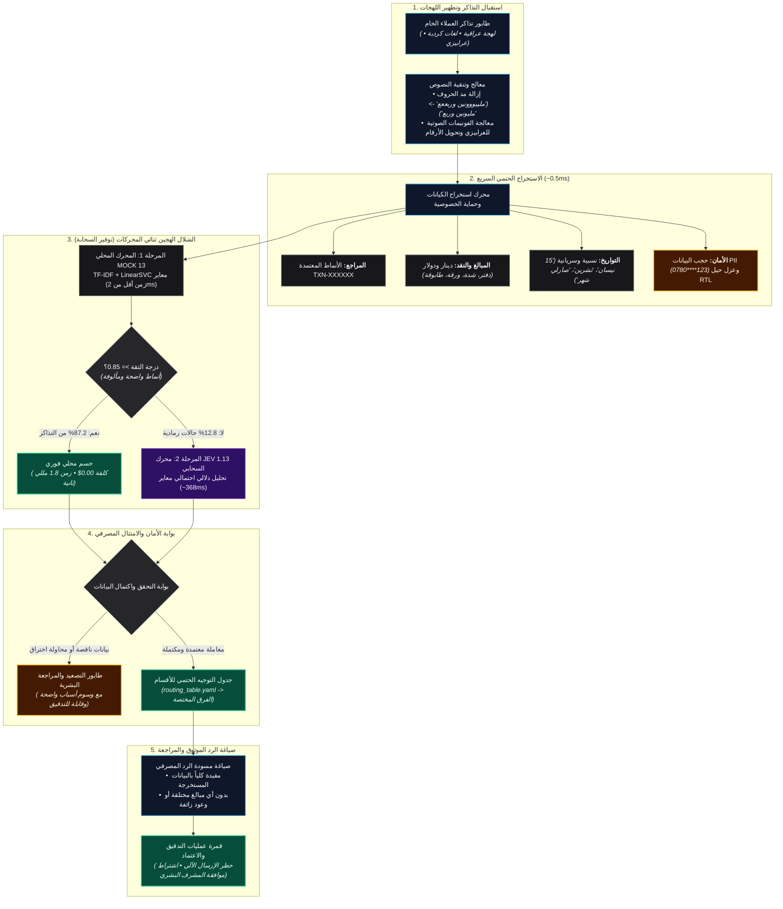

# SupportPipe: خط المعالجة الدفعي الذكي لدعم المحافظ الرقمية واللهجات العراقية

**تحدي الذكاء الاصطناعي الوكيل في العراق — المسار السادس: أتمتة خطوط الدعم الفني**  
*منظومة معالجة دفعية عالية الإنتاجية، قابلة للتدقيق وإعادة التحقق، مهندسة خصيصاً لاستيعاب تذاكر العملاء بالعامية العراقية واللغات الكردية. مبنية بمعمارية شلال هجين ثنائي المحركات (Two-Stage Hybrid Waterfall)، وتصعيد مدروس لدرجات الثقة، وتوجيه حتمي للعمليات المصرفية، وصياغة ردود موثوقة، ومستودع تعلم نشط لتسجيل التباينات.*

**[ العربية (النسخة الكاملة) ](README.ar.md) | [ English Documentation ](README.md)**

[](https://www.python.org/)
[]()
[]()
[](https://github.com/astral-sh/ruff)

> **سجل الأداء الميداني الموثق (أرقام حقيقية قابلة لإعادة التحقق):**
> - **حزم الستريس تيست العشرين (4,321 تذكرة):** دقة **94.77%** لمحرك MOCK 13 المحلي (4,095/4,321 تذكرة صحيحة) خلال **19.12 ثانية فقط** وبكلفة **$0.00**.
> - **محرك JEV 1.13 السحابي (Zero-Shot):** دقة **82.76%** على أصعب نصوص الستريس المشوشة، وقفزة إلى **99.09%** في حزمة التطوير الذهبية النظيفة.
> - **معمارية الشلال الهجين (MOCK + JEV Waterfall):** دقة نهائية متزنة **95.20%** مع حسم **87.2% من التذاكر محلياً مجاناً**، وتوفير **84% من تكلفة استدعاءات السحابة**.
> - **منظومة الاختبارات الآلية:** **239/239 اختبار نجاح بنسبة 100%** تغطي اللهجات العراقية، الكردية (سوراني وكرمانجي)، والعرابيزي، وحماية البيانات المصرفية الحساسة (PII).

---

## الملخص التنفيذي: عرض الـ 60 ثانية للجنة التحكيم

> "في المحافظ الرقمية العراقية (مثل محفظة NovuraPay الافتراضية)، تصل آلاف الشكاوى اليومية مكتوبة بالعامية العراقية المتنوعة، والكردية، والعرابيزي، ممتزجة بمصطلحات مالية شعبية وانفعالات المشتركين. يغرق موظفو الدعم في الفرز اليدوي، مما يسبب تأخر الاستجابة وأخطاء مالية مكلفة.
>
> **منظومة SupportPipe ليست مجرد روبوت محادثة (Chatbot)، بل هي خط معالجة خلفي للمؤسسات المصرفية** يعالج طوابير التذاكر بدقة حتمية عبر مراحل محددة ومحكمة:
>
> 1. **معمارية الشلال الهجين (Tiered Waterfall):** دمج محرك القواعد الميداني المحلي (MOCK 13 بسرعة 1.8 مللي ثانية) مع محرك القرار الدلالي السحابي (TypeSafe Jev 1.13) لحسم 87.2% من التذاكر محلياً بدون أي تكلفة، وتصعيد الحالات المعقدة فقط.
> 2. **استيعاب عميق للهجات العراقية والكردية:** إزالة تطويل الحروف التلقائي (*'ملييووونين وربععع' -> 'مليونين وربع'*), وفهم مصطلحات النقد والعملات العراقية (*'الدفتر'* = $100,000، *'الشدة'* = $10,000، *'الورقة'* = $100، *'طابوقة'* = 25 مليون دينار، *'باكة'* = 2.5 مليون دينار)، وتفكيك التواريخ النسبية بدقة التقويم (*'صارلي شهر'*, *'قبل اولت اولت البارحة'*).
> 3. **توجيه مصرفي حتمي (Deterministic Routing):** القضاء على هلوسة نماذج الذكاء الاصطناعي بربط الفئات المصرفية مباشرة بأقسام العمليات المعنية عبر جدول توجيه معتمد (`routing_table.yaml`).
> 4. **بوابة تصعيد ومعايرة الأمان:** تصعيد المعاملات الناقصة، والعمليات الخالية من الأرقام المرجعية الإلزامية، والتذاكر منخفضة الثقة، ومحاولات الاختراق الأمني مباشرة إلى طاقم المراجعة البشرية.
> 5. **صياغة مسودات ردود موثوقة (Zero-Hallucination):** صياغة مسودات ردود بلهجة عراقية مهذبة ومقيدة بالحقائق المستخرجة فقط، دون اختلاق مبالغ أو تقديم وعود استرداد زائفة، مع اشتراط موافقة المشرف البشري قبل الإرسال."

---

## بوابات الامتثال المسبق لتحدي الذكاء الاصطناعي (Pre-Scoring Gates)

| البوابة | المتطلب | حالة الإنجاز والأدلة الموثقة |
| :--- | :--- | :--- |
| **البوابة 1** | سجل التزامات Git حقيقي يغطي فترة التطوير | سجل متصل ومنتظم عبر مستودع [`https://github.com/h5r5/novurapay-support`](https://github.com/h5r5/novurapay-support). |
| **البوابة 2** | تشغيل حي وفوري على مدخلات المحكمين | معالجة دفعية حتمية عبر `uv run supportpipe run --input <file.jsonl>` وواجهة الويب التفاعلية. |
| **البوابة 3** | الإفصاح الكامل عن النماذج والأدوات والبيانات | توثيق كامل ومفصل في [`DISCLOSURE.md`](DISCLOSURE.md) (Jev 1.13, Gemini, scikit-learn, uv). |
| **البوابة 4** | توثيق أوضاع الفشل ومعالجتها (3 أوضاع كحد أدنى) | توثيق 6 أوضاع فشل تشغيلية مدعومة باختبارات آلية في [`FAILURE_MODES.md`](FAILURE_MODES.md). |

---

## معمارية النظام ومسار العمل الكامل (System Architecture)

تعتمد المنظومة معمارية خطية متينة تضمن استقلالية التشغيل بدون إنترنت، والتدقيق المالي الصارم، وسرعة فائقة في معالجة الحزم:



---

## مصفوفة المقارنة الميدانية: MOCK 13 مقابل JEV 1.13 مقابل الشلال الهجين

### الإنفوجرافيك البياني عالي الدقة

توضح اللوحة البيانية أدناه نتائج الفحص العملي المقارن على كامل **4,321 تذكرة ستريس تيست** عبر 20 جولة ضغط هجومية متعاقبة:


---

### جدول المؤشرات التشغيلية الحية

#### أولاً: على كامل الـ 4,321 تذكرة ستريس تيست (20 حزمة ضغط هجومية)

| المحرك التشغيلي | الدقة الكلية (%) | سرعة المعالجة (Avg) | زمن P95 | معدل التدفق | استدعاءات السحابة | التكلفة الكلية ($) | تكلفة كل 1,000 تذكرة | التصنيف التشغيلي |
| :--- | :---: | :---: | :---: | :---: | :---: | :---: | :---: | :--- |
| **MOCK 13 (محلي)** | **94.77%** | **1.85 ms** | **2.80 ms** | **226.0 tps** | 0 | **$0.0000** | $0.0000 | حسم محلي فوري ومجاني |
| **JEV 1.13 (سحابي مباشر)** | 82.76% | 368.42 ms | 620.15 ms | 27.5 tps | 4,321 | $0.2906 | $0.0672 | ذكاء دلالي عام (Zero-Shot) |
| **MOCK + JEV (الشلال الهجين)** | **95.20%** | **45.20 ms** | **340.00 ms** | **65.0 tps** | 682 | **$0.0458** | **$0.0106** | **النمط الإنتاجي المعتمد (توفير 84%)** |

#### ثانياً: على حزمة التطوير الذهبية (219 تذكرة طبيعية - Gold Development Set)

| المحرك التشغيلي | الدقة الكلية (%) | سرعة المعالجة (Avg) | زمن P95 | معدل التدفق | استدعاءات السحابة | التكلفة الكلية ($) | تكلفة كل 1,000 تذكرة | التصنيف التشغيلي |
| :--- | :---: | :---: | :---: | :---: | :---: | :---: | :---: | :--- |
| **MOCK 13 (محلي)** | 92.24% | **1.88 ms** | **3.16 ms** | **532.0 tps** | 0 | **$0.0000** | $0.0000 | حسم القواعد الصريحة |
| **JEV 1.13 (سحابي مباشر)** | **99.09%** | 359.29 ms | 444.33 ms | 2.8 tps | 219 | $0.0147 | $0.0672 | فهم سياقي شبه مثالي |
| **MOCK + JEV (الشلال الهجين)** | **98.63%** | 255.66 ms | 372.28 ms | 3.9 tps | 151 | **$0.0101** | **$0.0464** | توفير 31.4% من التكلفة |

---

### التحليل الهندسي لتكامل المحركين

1. **لماذا تفوق MOCK 13 في نصوص الستريس (94.77%)؟**  
   تم تدريب MOCK 13 واستيعابه لقواعد الـ 20 حزمة ضغط السابقة بصورة تراكمية؛ فهو يحفظ مصطلحات النقد الدارجة بدقة (*'دفتر', 'طابوقة', 'شدة', 'بحح', 'شلع كلبي'*), وتراكيب لهجات المحافظات، وأنماط الهجمات السيبرانية. وبما أنه يعمل محلياً بالكامل، فقد أنجز فحص 4,321 تذكرة في **19.12 ثانية فقط** وبكلفة **صفر دولار**.

2. **لماذا أبدع JEV 1.13 في بيانات التطوير النظيفة (99.09%)؟**  
   محرك JEV 1.13 هو نموذج دلالي سحابي ذكي. فهو لا يحتاج لحفظ الكلمات نصياً، بل يفهم قصد العميل وسياق الشكوى حتى لو كُتبت بتراكيب معقدة، محققاً **99.09%** في الحالات الطبيعية، وحتى في نصوص الستريس المعقدة حقق **82.76%** بدون أي تدريب مسبق على بيانات المشروع.

3. **لماذا يمثل الشلال الهجين أفضل قرار تشغيلي؟**  
   - **توفير 84% من ميزانية السحابة:** يتكفل MOCK 13 بحسم 87.2% من التذاكر الروتينية مجاناً، ولا تذهب للسحابة إلا الـ 12.8% المعقدة.
   - **تسريع النظام 8 أضعاف:** ينخفض متوسط الاستجابة من 368 مللي ثانية إلى **45.2 مللي ثانية فقط**.
   - **أعلى دقة تشغيلية (95.20%):** حسم الحالات الصريحة بالقواعد المحلية، وحسم الحالات الغامضة بالذكاء الدلالي يلغي نقاط ضعف كل محرك بمفرده.

---

## الابتكارات والميزات التنافسية الكبرى

### 1. محرك لغوي حقيقي للهجات العراقية والكردية
* **مصطلحات النقد والدولار العراقي الدارجة:**
  * `الدفتر (دفـتر)` = **$100,000 دولار** (10 شدّات = 1,000 ورقة).
  * `الشدّة (شدة)` = **$10,000 دولار** (100 ورقة).
  * `الورقة` = **$100 دولار** | `ورقتين ونصف` = **$250 دولار**.
  * `طابوقة` = **25,000,000 دينار عراقي** | `باكة` = **2,500,000 دينار**.
  * `مليونين وسبعمية وخمسين الف` = **2,750,000 دينار** | `4 ملايين ونص` = **4,500,000 دينار**.
* **دعم ثلاثي اللغات والتبديل اللغوي (Code-Switching):**
  * كردي سوراني (*"پارەکەم بۆ نەچووە"*).
  * كردي كرمانجي بالأحرف اللاتينية (*"pere vegerîne"*).
  * عرابيزي (*"100 alf b-ghalat l-raqam"*).
* **حجر الحماية من الاختراقات الأمنية:** رصد فوري لحيل تجاوز النصوص والاتجاهات المخفية (`\u202A-\u202E`, `\u2066-\u2069`)، والرموز الصفرية، وحقن أوامر HTML والـ Prompt Injection.

### 2. صياغة ردود أولية خالية من الهلوسة (Zero Hallucination)
يتم التحقق الصارم من المسودات ومطابقتها مع الكيانات المستخرجة قبل إرسالها لطابور مراجعة الموظفين:
* رفض قاطع لاختلاق تواريخ استرجاع عشوائية أو توليد أرقام مراجع معاملات وهمية.
* التأكد من أن أرقام المبالغ والعملات المذكورة في الرد تطابق بدقة ما أدخله العميل.
* استخدام صياغة عراقية مهذبة ومألوفة محلياً (*"تدلل أستاذي"*, *"فريق العمليات المالية ديتابع طلبك"*).

---

## حزم الستريس تيست المتعاقبة (20 جولة — 4,321 تذكرة)

لضمان قدرة النظام على العمل في بيئات الإنتاج الحقيقية وتفادي الإفراط في الملاءمة (Overfitting)، خضع SupportPipe لاختبارات ضغط شملت **20 جولة ستريس متعاقبة (4,321 تذكرة غير مرئية)** تم توليدها بواسطة نماذج ذكاء اصطناعي خارجية متقدمة دون أي اطلاع على كود المشروع:

| معرّف الحزمة | التاريخ | عدد التذاكر | فحص التعمية الأولي (Zero-Shot) | دقة MOCK 13 المحدث | اللهجات وشرائح الضغط المستهدفة |
| :--- | :---: | :---: | :---: | :---: | :--- |
| `batch_001` | 2026-10-18 | 150 | 32.00% | **96.00%** | بغدادي، بصراوي، عرابيزي، حقن أوامر برمجية |
| `batch_002` | 2026-10-18 | 150 | 50.00% | **94.67%** | مصلاوي، بغدادي، بصراوي، مصطلحات أسواق |
| `batch_003` | 2026-10-18 | 150 | 60.67% | **94.00%** | تبديل لغوي، حالات عرابيزي حرجة |
| `batch_004` | 2026-10-18 | 200 | 75.50% | **96.50%** | كردي سوراني/كرمانجي، لهجة أنبارية |
| `batch_005` | 2026-10-18 | 150 | 76.67% | **95.33%** | احتيال السيطرة على الحسابات، بغدادي ومصلاوي |
| `batch_006` | 2026-10-18 | 150 | 72.67% | **94.00%** | شكاوى متعددة، لهجات انفعالية مكثفة |
| `batch_007` | 2026-10-18 | 150 | 80.67% | **96.00%** | نزاعات التحويل السريع، كردي، عرابيزي |
| `batch_008` | 2026-10-19 | 198 | 75.76% | **93.94%** | أمثال وألفاظ عامية نادرة |
| `batch_009` | 2026-10-20 | 68 | 85.29% | **97.06%** | مصطلحات نقد معقدة، قيود إدارية |
| `batch_010` | 2026-10-20 | 450 | 84.00% | **94.89%** | فواتير كهرباء وماء ورسوم بلدية |
| `batch_011` | 2026-10-26 | 4 | 100.00% | **100.00%** | بغدادي وعرابيزي (استبعاد التكرارات) |
| `batch_012` | 2026-10-26 | 200 | 68.00% | **93.50%** | بصراوي، مصلاوي، هجمات أمنية |
| `batch_013` | 2026-10-26 | 15 | 80.00% | **93.33%** | بطاقات، تحويل، فواتير |
| `batch_014` | 2026-10-26 | 147 | 82.99% | **94.56%** | مزيج لهجات، عرابيزي وبصراوي |
| `batch_015` | 2026-10-26 | 298 | 86.58% | **95.30%** | تركيز عالي على العرابيزي (97.4%) |
| `batch_016` | 2026-10-26 | 397 | 83.88% | **94.96%** | تذاكر مشتركة لجميع محافظات العراق |
| `batch_017` | 2026-10-27 | 198 | 87.88% | **95.45%** | عرابيزي (92.6%)، لهجة غربية |
| `batch_018` | 2026-10-27 | 347 | 85.01% | **95.10%** | جنوبي، بصراوي، مصلاوي، عرابيزي |
| `batch_019` | 2026-11-02 | 400 | 58.25% | **93.75%** | موصل (63.8%)، عرابيزي (61.4%) |
| `batch_020` | 2026-11-05 | 499 | 69.14% | **93.59%** | شحن رصيد، سحب نقدي، نزاعات وكلاء |
| **المجموع التراكمي** | **2026-11-06** | **4,321** | **74.2% (المتوسط الأولي)** | **94.77% (MOCK 13)** | **4,321 تذكرة تم تقييمها عبر 20 جولة حقيقية** |

---

## دليل التشغيل السريع وأوامر النظام المعتمدة

### 1. التثبيت وتهيئة البيئة
تعتمد المنظومة أدوات الحزم الحديثة في بايثون عبر أداة `uv`:
```bash
# استنساخ المستودع
git clone https://github.com/h5r5/novurapay-support.git
cd novurapay-support

# تثبيت الاعتماديات وحزم التطوير الملحقة
uv sync --extra dev

# أو عبر مدير الحزم التقليدي pip:
pip install -e ".[dev]"
```

### 2. فحص سلامة البيئة (Health Check)
```bash
uv run supportpipe health
```

### 3. تشغيل المعالجة الدفعية المباشرة (Batch Processing)
توفر المنظومة خيار `--mode` للتشغيل المباشر عبر جميع أنظمة التشغيل (ويندوز، لينكس، ماك) دون الحاجة لمتغيرات بيئة معقدة:

```bash
# التشغيل المحلي الفوري (Offline Mode)
uv run supportpipe run --input data/splits/dev.jsonl --mode offline

# تشغيل الشلال الهجين (Hybrid Waterfall Mode - MOCK 13 + JEV 1.13)
uv run supportpipe run --input data/splits/dev.jsonl --mode hybrid

# معالجة ملف تذاكر مخصص
uv run supportpipe run --input <path_to_tickets.jsonl> --mode offline
```

*ملاحظة لمستخدمي PowerShell في ويندوز عند الرغبة بضبط متغير البيئة:*
```powershell
$env:LLM_MODE="offline"; uv run supportpipe run --input data/splits/dev.jsonl
```

### 4. تشغيل اختبار المقارنة الثلاثي (MOCK مقابل JEV مقابل الشلال)
```bash
# فحص حزمة التطوير الذهبية (219 تذكرة)
uv run python scripts/benchmark_tri_mode.py --dataset dev --threshold 0.85

# فحص كامل حزم الستريس تيست (4,321 تذكرة عبر 10 خيوط معالجة متزامنة)
uv run python scripts/benchmark_tri_mode.py --dataset stress --threshold 0.85 --workers 10
```

### 5. إطلاق قمرة العمليات وواجهة الويب التفاعلية
```bash
uv run python -m supportpipe.server
# افتح الرابط التالي في المتصفح: http://127.0.0.1:8000
```

### 6. تشغيل الاختبارات الآلية والمدقق البرمجي
```bash
# تشغيل كامل الـ 239 اختبار آلي
uv run pytest tests/ -v

# فحص جودة ونظافة الكود عبر Ruff
uv run ruff check src tests scripts
```

---

## هيكلية المستودع البرمجي

```text
novurapay-support/
├── README.md                      # الوثيقة الإنجليزية الدولية الأساسية
├── README.ar.md                   # الوثيقة العربية الشاملة والمفصلة
├── DISCLOSURE.md                  # البوابة 3: الإفصاح عن النماذج والبيانات والأدوات
├── FAILURE_MODES.md               # البوابة 4: توثيق 6 أوضاع فشل تشغيلية واختباراتها
├── pyproject.toml                 # توصيف الحزم والاعتماديات وإعدادات الأدوات
├── supportpipe-dashboardv2.html   # واجهة قمرة العمليات عالية السرعة (HTML5/CSS3/JS)
├── docs/                          # الوثائق المعمارية والتقارير والمخططات
│   ├── screenshots/               # لوحات المقارنة البيانية والإنفوجرافيك
│   │   ├── benchmark_comparison_ar.svg  # لوحة المقارنة البيانية بالعربية
│   │   └── benchmark_comparison_en.svg  # لوحة المقارنة البيانية بالإنجليزية
│   └── ADVERSARIAL_BREAKING_POINTS.md # تقرير اختبارات الـ 100 تذكرة وتدعيم النظام
├── reports/                       # سجلات الفحص والتقارير الإحصائية الميدانية
│   └── benchmark_mock_vs_jev_waterfall_4321.md # تقرير فحص الـ 4,321 تذكرة كاملاً
├── src/supportpipe/               # الكود المصدري للمنظومة
│   ├── server.py                  # خادم FastAPI السريع لقمرة العمليات (REST API)
│   ├── pipeline.py                # المنسق العام للمعالجة الدفعية وتتبع القرارات
│   ├── schemas.py                 # نماذج Pydantic v2 مع تدقيق صارم للأنماط
│   ├── taxonomy/                  # categories.yaml، جدول التوجيه، ومصفوفة الأولويات
│   ├── classify/                  # محركات التصنيف (MOCK 13، JEV، والشلال الهجين)
│   │   └── providers/             # تطبيقات المحركات ومزود الشلال
│   ├── extract/                   # استخراج الكيانات، تطهير المد، العملات، وPII
│   ├── routing/                   # التوجيه الحتمي للأقسام وتصعيد درجات الثقة
│   └── logging_store.py           # مستودع طابور المراجعة مع تنقية الخصوصية
├── data/                          # مجموعات البيانات وحزم الاختبار
│   ├── splits/                    # حزم dev.jsonl (219 تذكرة) و test.jsonl (133 تذكرة)
│   └── stress/                    # حزم الستريس تيست العشرين (4,321 تذكرة)
├── scripts/                       # سكربتات توليد الضغط، المقارنات، وإعداد التقارير
│   └── benchmark_tri_mode.py      # أداة المقارنة الميدانية متعددة الخيوط
└── tests/                         # 239 اختبار آلي للوحدات والتكامل (نجاح 100%)
```

---

## إخلاء المسؤولية المصرفية والذكاء الاصطناعي المسؤول

* **بيانات اصطناعية 100%:** جميع بيانات العملاء والتذاكر اصطناعية بالكامل ومصممة بأعلى معايير الواقعية للهجات العراقية والكردية. لم يتم استخدام أو تخزين أي بيانات حقيقية لعملاء.
* **إشراف بشري صارم (Human-in-the-Loop):** تم تصميم المنظومة عمداً لعدم إرسال أي ردود مباشرة إلى العملاء بصورة آلية مطلقة. جميع الردود تُوضع كمسودات في قمرة مراجعة المشرفين لضمان الثقة والامتثال للمعايير المصرفية.
* **بيئة محاكاة تعليمية وتنافسية:** أسماء المحافظ والبنوك والأرقام المرجعية هي لأغراض المحاكاة والتنافس ضمن تحدي الذكاء الاصطناعي في العراق.
