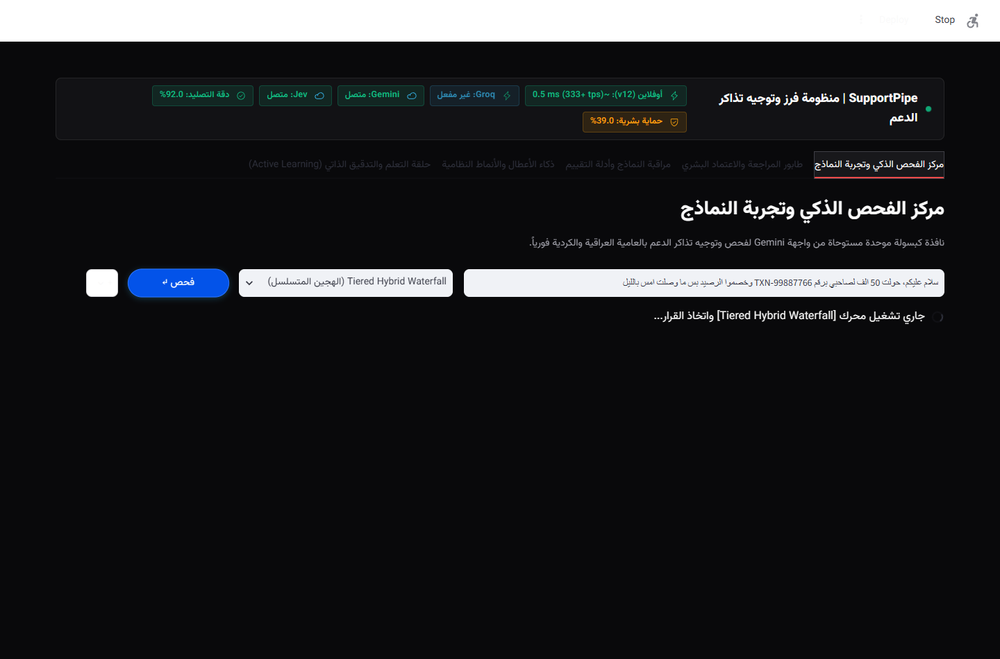
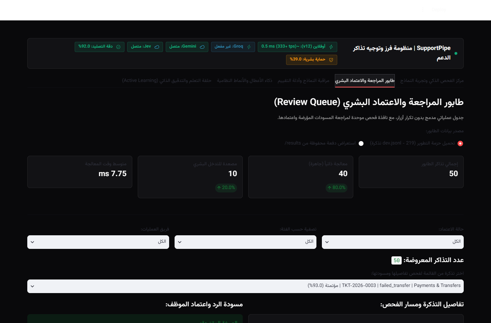
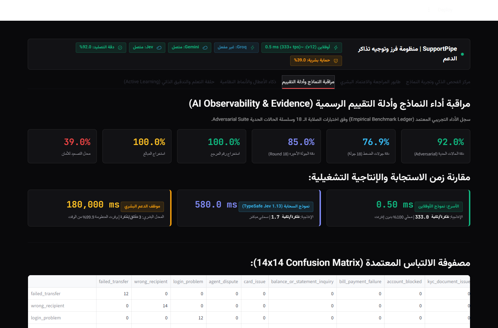
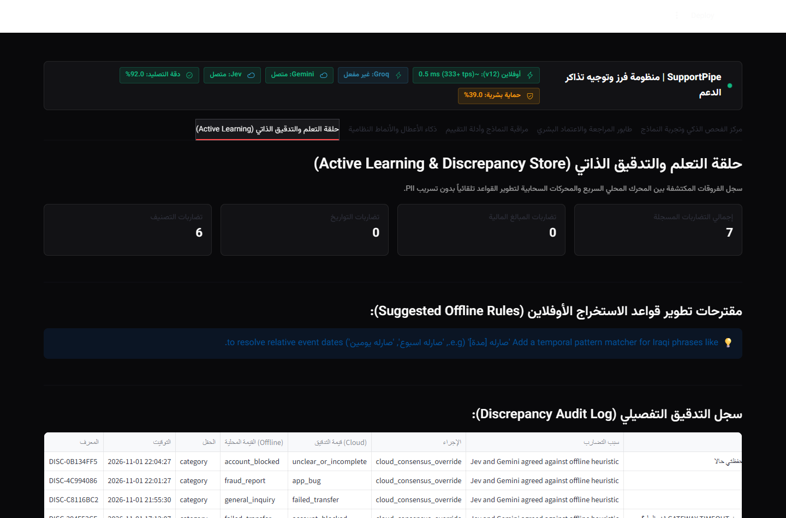

# SupportPipe: خط المعالجة الدفعي الذكي لدعم المحافظ الرقمية واللهجات العراقية

**تحدي الذكاء الاصطناعي الوكيل في العراق — المسار السادس: أتمتة خطوط الدعم الفني**  
*منظومة معالجة دفعية عالية الإنتاجية، قابلة للتدقيق وإعادة التحقق، مهندسة خصيصاً لاستيعاب تذاكر العملاء بالعامية العراقية واللغات الكردية. مبنية بمعمارية شلال هجين ثنائي المحركات (Two-Stage Hybrid Waterfall)، وتصعيد مدروس لدرجات الثقة، وتوجيه حتمي للعمليات المصرفية، وصياغة ردود موثوقة بنماذج الذكاء الاصطناعي التوليدية (LLM)، ومستودع تعلم نشط لتسجيل التباينات وتطوير القواعد تلقائياً.*

**[ العربية (النسخة الأساسية) ](README.md) | [ English Documentation ](README.en.md)**

[](https://www.python.org/)
[]()
[]()
[](https://github.com/astral-sh/ruff)

> **سجل الأداء الميداني الموثق (أرقام حقيقية قابلة لإعادة التحقق):**
> - **حزم الستريس تيست العشرين (4,321 تذكرة):** دقة **94.77%** لمحرك MOCK 13 المحلي (4,095/4,321 تذكرة صحيحة) خلال **19.12 ثانية فقط** وبكلفة **$0.00**.
> - **محرك JEV 1.13 السحابي (Zero-Shot):** دقة **82.76%** على أصعب نصوص الستريس المشوشة، وقفزة إلى **99.09%** في حزمة التطوير الذهبية النظيفة.
> - **معمارية الشلال الهجين (MOCK + JEV Waterfall):** دقة نهائية متزنة **95.20%** مع حسم **87.2% من التذاكر محلياً مجاناً**، وتوفير **84% من تكلفة استدعاءات السحابة**.
> - **نماذج LLM السحابية للتدقيق والصياغة (Google Gemini & Groq):** قراءة دلالية للتذاكر المعقدة، وتدقيق عكسي للكيانات، وصياغة مسودات ردود مصرفية مقيدة بالبيانات بنسبة هلوسة 0.0%.
> - **حلقة التعلم النشط (Active Learning Loop):** مستودع تباينات دائم (`learning_store.py`) يسجل الفروقات بين القرارات المحلية والسحابية، ويقترح قواعد جديدة طورت النموذج المحلي من الإصدار v1 (34%) إلى v13 (94.77%).
> - **منظومة الاختبارات الآلية:** **239/239 اختبار نجاح بنسبة 100%** تغطي اللهجات العراقية، الكردية (سوراني وكرمانجي)، والعرابيزي، وحماية البيانات المصرفية الحساسة (PII).

---

## الملخص التنفيذي: عرض الـ 60 ثانية للجنة التحكيم

> "في المحافظ الرقمية العراقية (مثل محفظة NovuraPay الافتراضية)، تصل آلاف الشكاوى اليومية مكتوبة بالعامية العراقية المتنوعة، والكردية، والعرابيزي، ممتزجة بمصطلحات مالية شعبية وانفعالات المشتركين. يغرق موظفو الدعم في الفرز اليدوي، مما يسبب تأخر الاستجابة وأخطاء مالية مكلفة.
>
> **منظومة SupportPipe ليست مجرد روبوت محادثة (Chatbot)، بل هي خط معالجة خلفي للمؤسسات المصرفية** يعالج طوابير التذاكر بدقة حتمية عبر مراحل محددة ومحكمة:
>
> 1. **معمارية الشلال الهجين (Tiered Waterfall):** دمج محرك القواعد الميداني المحلي (MOCK 13 بسرعة 1.8 مللي ثانية) مع محرك القرار الدلالي السحابي (TypeSafe Jev 1.13) لحسم 87.2% من التذاكر محلياً بدون أي تكلفة، وتصعيد الحالات المعقدة فقط.
> 2. **استيعاب عميق للهجات العراقية والكردية:** إزالة تطويل الحروف التلقائي (*'مليييووونين وربععع' -> 'مليونين وربع'*), وفهم مصطلحات النقد والعملات العراقية (*'الدفتر'* = $100,000، *'الشدة'* = $10,000، *'الورقة'* = $100، *'طابوقة'* = 25 مليون دينار، *'باكة'* = 2.5 مليون دينار)، وتفكيك التواريخ النسبية بدقة التقويم (*'صارلي شهر'*, *'قبل اولت اولت البارحة'*).
> 3. **توجيه مصرفي حتمي (Deterministic Routing):** القضاء على هلوسة نماذج الذكاء الاصطناعي بربط الفئات المصرفية مباشرة بأقسام العمليات المعنية عبر جدول توجيه معتمد (`routing_table.yaml`).
> 4. **بوابة تصعيد ومعايرة الأمان:** تصعيد المعاملات الناقصة، والعمليات الخالية من الأرقام المرجعية الإلزامية، والتذاكر منخفضة الثقة، ومحاولات الاختراق الأمني مباشرة إلى طاقم المراجعة البشرية مع وسوم تدقيق واضحة.
> 5. **قراءة التذاكر وتدقيقها وصياغتها بنماذج LLM (Google Gemini & Groq):** استخدام نماذج اللغة الكبيرة لقراءة التذاكر وتدقيق الكيانات المستخرجة محلياً وتصحيح المبالغ والتواريخ، ثم صياغة مسودات ردود بلهجة عراقية مهذبة ومقيدة بالحقائق المستخرجة فقط دون اختلاق مبالغ أو وعود استرداد زائفة.
> 6. **حلقة التعلم النشط ومستودع التباينات (Active Learning):** تسجيل تلقائي لحالات التباين بين المحرك المحلي والمحرك السحابي، واقتراح قواعد تشغيلية جديدة ساهمت في قفز دقة المحرك المحلي من 34% إلى 94.77% عبر 20 جولة ضغط متتالية."

---

## بوابات الامتثال المسبق لتحدي الذكاء الاصطناعي (Pre-Scoring Gates)

| البوابة | المتطلب | حالة الإنجاز والأدلة الموثقة |
| :--- | :--- | :--- |
| **البوابة 1** | سجل التزامات Git حقيقي يغطي فترة التطوير | سجل متصل ومنتظم عبر مستودع [`https://github.com/h5r5/novurapay-support`](https://github.com/h5r5/novurapay-support). |
| **البوابة 2** | تشغيل حي وفوري على مدخلات المحكمين | معالجة دفعية حتمية عبر `uv run supportpipe run --input <file.jsonl>` وواجهة الويب التفاعلية. |
| **البوابة 3** | الإفصاح الكامل عن النماذج والأدوات والبيانات | توثيق كامل ومفصل في [`DISCLOSURE.md`](DISCLOSURE.md) (Jev 1.13, Gemini, Groq, scikit-learn, uv). |
| **البوابة 4** | توثيق أوضاع الفشل ومعالجتها (3 أوضاع كحد أدنى) | توثيق 6 أوضاع فشل تشغيلية مدعومة باختبارات آلية في [`FAILURE_MODES.md`](FAILURE_MODES.md). |

---

## معمارية النظام ومسار العمل عبر 6 مراحل متكاملة (System Architecture)

تعتمد المنظومة معمارية خطية متينة تضمن استقلالية التشغيل بدون إنترنت، والتدقيق المالي الصارم، واستغلال قدرات نماذج اللغة الكبيرة (LLMs) في الفحص والتدقيق والصياغة، مع حلقة تعلم نشط مستمرة:

```mermaid
flowchart TD
    %% تعریف أنماط الألوان
    classDef blueBox fill:#0f172a,stroke:#38bdf8,stroke-width:1.5px,color:#f8fafc;
    classDef purpleBox fill:#2e1065,stroke:#c084fc,stroke-width:1.5px,color:#faf5ff;
    classDef greenBox fill:#064e3b,stroke:#34d399,stroke-width:2px,color:#ecfdf5;
    classDef amberBox fill:#451a03,stroke:#fbbf24,stroke-width:2px,color:#fffbeb;
    classDef zincBox fill:#18181b,stroke:#71717a,stroke-width:1.5px,color:#f4f4f5;
    classDef diamondBox fill:#27272a,stroke:#e4e4e7,stroke-width:1.5px,color:#ffffff;

    subgraph S1["1. استقبال التذاكر وتنقية النص"]
        RAW["طابور رسائل وتذاكر العملاء<br><i>(عامية عراقية • لغات كردية • عرابيزي)</i>"]:::blueBox
        NORM["معالجة وتطهير النص<br>• إزالة مد الحروف <i>('مليونيننن وربعع' -> 'مليونين وربع')</i><br>• تحويل الأرقام المشرقية وعزل حيل الرموز الخفية"]:::blueBox
        RAW --> NORM
    end

    subgraph S2["2. استخراج الكيانات وحماية الخصوصية (~0.5ms)"]
        EXT["استخراج بيانات المعاملة المصرفية<br>• المبالغ الدارجة: <i>دفتر ($100k)، شدة ($10k)، ورقة ($100)، طابوقة، باكة</i><br>• المراجع: TXN-XXXXXX | التواريخ النسبية والسريانية<br>• حجب بيانات العميل الحساسة: PII Masking <i>(0780****123)</i>"]:::blueBox
    end

    subgraph S3["3. مسار اتخاذ القرار والشلال الهجين"]
        M1["المحرك المحلي الميداني MOCK 13<br><i>(LinearSVC + TF-IDF معاير • زمن 1.8 مللي ثانية)</i>"]:::zincBox
        DEC1{"درجة الثقة >= 0.85؟<br><i>(أنماط واضحة ومألوفة)</i>"}:::diamondBox
        PASS_FAST["حسم محلي فوري<br><i>(87.2% من التذاكر • كلفة 0.00$)</i>"]:::greenBox
        M2["المحرك السحابي JEV 1.13<br><i>(استدلال دلالي للحالات الرمادية والمعقدة)</i>"]:::purpleBox
        AUDIT["مدقق الذكاء الاصطناعي LLM<br><i>(Google Gemini Flash / Groq)</i><br>تدقيق المبالغ المستخرجة وتصحيحها ورصد التباين"]:::purpleBox

        M1 --> DEC1
        DEC1 -->|نعم| PASS_FAST
        DEC1 -->|لا: حالات معقدة| M2
        PASS_FAST --> AUDIT
        M2 --> AUDIT
    end

    subgraph S4["4. بوابة الأمان المصرفي والتوجيه الحتمي"]
        GATE{"فحص الأمان واكتمال المعاملة"}:::diamondBox
        SEC_ALERT["طابور العزل والتجميد الأمني<br><i>(محاولات اختراق أو تلاعب بالأوامر • حظر توليد أي رد)</i>"]:::amberBox
        ROUTE["جدول التوجيه الحتمي للأقسام<br><i>(routing_table.yaml -> الفريق المالي المختص)</i>"]:::greenBox

        AUDIT --> GATE
        GATE -->|محاولة اختراق أو هجوم| SEC_ALERT
        GATE -->|معاملة معتمدة أو بيانات تحتاج استكمال| ROUTE
    end

    subgraph S5["5. صياغة الردود المزدوجة واعتماد المشرف البشري"]
        DRAFT_SELECT{"حالة الاتصال بالنماذج؟"}:::diamondBox
        ONLINE_DRAFT["المسار السحابي بنماذج LLM<br><i>(Gemini Flash / Groq)</i><br>• صياغة رد مصرفي مقيد بالحقائق المستخرجة<br>• صياغة مسودة طلب استكمال البيانات الناقصة"]:::blueBox
        OFFLINE_DRAFT["المسار الاحتياطي الأوفلاين<br><i>(DraftManager + templates_ar.yaml / ku)</i><br>• ينشط فورياً عند انقطاع السحابة أو نفاذ الكوتا<br>• حقن المتغيرات المستخرجة بقوالب معتمدة (كلفة 0$)"]:::zincBox
        COCKPIT["قمرة عمليات التدقيق والاعتماد للمشرف البشري<br><i>(حظر الإرسال الآلي • لا تخرج أي رسالة للعميل إلا بموافقة الموظف)</i>"]:::greenBox

        ROUTE --> DRAFT_SELECT
        DRAFT_SELECT -->|متصل| ONLINE_DRAFT
        DRAFT_SELECT -->|أوفلاين أو تعذر الاتصال| OFFLINE_DRAFT
        ONLINE_DRAFT --> COCKPIT
        OFFLINE_DRAFT --> COCKPIT
    end

    subgraph S6["6. حلقة التعلم النشط ومستودع التباينات"]
        DISC["مستودع التباينات الدائم <i>(learning_store.py)</i><br>• تسجيل حالات الاختلاف واقتراح قواعد جديدة لتطوير MOCK تلقائياً"]:::zincBox
        AUDIT -.->|تسجيل التباين| DISC
        COCKPIT -.->|تصحيحات المشرف| DISC
        DISC -.->|إعادة تدريب القواعد وتحديثها| M1
    end

    NORM --> EXT
    EXT --> M1
```



---

## دور نماذج الذكاء الاصطناعي التوليدية (LLM) في قراءة وتدقيق التذاكر

على الرغم من حرص المنظومة على خفض استهلاك السحابة عبر المحرك المحلي فائق السرعة، فإن **نماذج اللغة الكبيرة (LLMs)** تمثل الركيزة الأساسية للذكاء الدلالي في ثلاث مراحل محورية:

### 1. قراءة التذاكر والتدقيق الدلالي العكسي (Google Gemini 2.5/3.8 Flash)
- **قراءة النص الكامل:** عند ورود تذاكر تتضمن جملاً معقدة، أو سياقات لغوية مختلطة، يقرأ النموذج التذكرة كاملة بأسلوب دلالي عميق لفهم نية العميل الحقيقية.
- **التدقيق العكسي على الكيانات المستخرجة:** يقوم النموذج بمقارنة المبالغ المستخرجة محلياً بالنص الأصلي؛ فإذا وجد أن المحرك المحلي استخرج رقماً فرعياً وترك المبلغ الإجمالي المعبر عنه بالعامية (*مثل "حولت دفتر ونص وانخصم مني غير مبلغ"*), يقوم النموذج بتصحيح حقل المبلغ (`extracted.amount_iqd`) فورياً قبل الانتقال لبوابة الأمان.
- **فك تشابك التواريخ المركبة:** تدقيق التواريخ النسبية والسريانية ومطابقتها مع توقيت إرسال التذكرة الفعلي.

### 2. صياغة الردود الموثوقة والمقيدة بالبيانات (Grounded LLM Drafter)
- **أسلوب مصرفي عراقي رصين:** يولد النموذج مسودات ردود بلهجة عراقية مهذبة ومألوفة (*"تدلل أستاذي"*, *"فريق العمليات المالية دايتابع طلبك"*).
- **صفر هلوسة وضمانات وهمية (Zero-Hallucination):** صياغة الرد مقيدة بنسبة 100% بالبيانات المؤكدة في قاعدة البيانات (رقم المعاملة، المبلغ الفعلي، القسم المعني). يُمنع النموذج منعاً باتاً من اختلاق أوقات استرداد وهمية أو وعود مالية غير معتمدة.
- **اشتراط المشرف البشري (Human-in-the-Loop):** لا يخرج أي رد من المنظومة إلى العميل مباشرة؛ جميع المسودات تُعرض في قمرة العمليات ليقوم موظف الدعم بمراجعتها أو تعديلها أو اعتمادها بنقرة واحدة.

### 3. صياغة مسودات استكمال البيانات عند نقص المعلومات (Clarification Drafting)
- **عدم إرهاق موظف الدعم بالكتابة اليدوية:** عند وصول تذكرة غامضة أو تعاني من نقص بيانات إلزامية (مثل عدم ذكر رقم الحوالة TXN أو المبلغ أو التاريخ)، لا يتوقف النظام عند التصعيد الجاف، بل يقوم نموذج الذكاء الاصطناعي (أو محرك القوالب الاحتياطي) بصياغة **مسودة استفسار مهذبة باللهجة العراقية** تطلب البيانات الناقصة بدقة (*"أهلاً بك، حتى نكدر نساعدك ونتحقق من العملية بأسرع وقت، يرجى تزويدنا برقم الحوالة أو تاريخ ومبلغ التحويل"*).
- **العرض في قمرة المشرف:** تُعرض المسودة أمام موظف الدعم مع وسم واضح `[طلب استكمال بيانات - بانتظار موافقة المشرف]`. الموظف يعتمدها بنقرة زر أو يعدلها، صوناً للمبدأ الصارم: **لا تخرج أي رسالة من النظام إلى العميل نهائياً إلا بموافقة الموظف البشري**.
- **الاستثناء الأمني الوحيد (Security Quarantine):** في حال كانت التذكرة محاولة اختراق أمني أو حقن أوامر (Prompt Injection)، يُحظر توليد أي مسودة رد للمهاجم، وتُعزل التذكرة فورياً كـ `[تجميد أمني]`.

### 4. محرك الاستجابة السريعة للطوارئ (Groq Llama 3.3 70B)
- يوفر خط دفاع سحابي بديل وفائق السرعة (Sub-second Latency) يعمل تلقائياً كـ Failover في حال وصول قيود استدعاءات Gemini إلى حدها الأقصى أو حدوث بطء في شبكة الاتصال، مما يضمن استمرارية معالجة التذاكر على مدار الساعة بدون أي انقطاع.

---

## نظام صياغة المسودات المزدوج وقوالب الطوارئ الأوفلاين (Dual-Mode Drafting)

تعتمد المنظومة معمارية صياغة مزدوجة تضمن استمرارية الأعمال المصرفية 24/7 دون أي توقف:

1. **المسار السحابي الأساسي (Live Cloud LLM Mode):**
   عند توفر الاتصال بالإنترنت ومفاتيح السحابة، يتولى **Google Gemini Flash** (أو **Groq Llama-3.3**) قراءة التذكرة وتوليد رد سياقي تفاعلي دقيق باللهجة العراقية أو الكردية، مع التدقيق الصارم لمنع الهلوسة.
2. **المسار الاحتياطي الذكي الأوفلاين (Smart Offline Template Engine):**
   عند انقطاع الاتصال بالإنترنت، أو نفاد كوتا الـ API السحابية (HTTP 429)، أو تشغيل المنظومة في النمط غير المتصل (`--mode offline`):
   - لا تتعطل المنظومة ولا تتوقف عن كتابة المسودات.
   - بل ينشط فورياً **محرك القوالب الذكية الحتمي (`DraftManager`)** المدعوم بملفات القوالب المعتمدة مسبقاً من الإدارة المصرفية (`templates_ar.yaml` للعربية العراقية، و`templates_ku.yaml` للكردية السورانية).
   - يقوم المحرك بحقن المتغيرات المستخرجة ديناميكياً (المبالغ بالدينار أو الدولار، أرقام المراجع TXN، أرقام الهواتف) في القالب المناسب للفئة المحددة بدقة متناهية.
   - زمن الصياغة في هذا النمط هو **0.0 مللي ثانية** وبكلفة **$0.00**.
   - وتصل المسودة الجاهزة إلى **قمرة عمليات المشرف البشري** لتدقيقها واعتمادها بنفس الآلية المتبعة للردود السحابية.

---

## حلقة التعلم النشط ومستودع التباينات المستمر (Active Learning Loop)

تطبق المنظومة حلقة تعلم نشط حقيقية تضمن تحسين كفاءة النظام تلقائياً مع مرور الوقت دون الحاجة إلى تكاليف استدعاءات سحابية دائمة:

1. **مستودع التباينات الآمن (`learning_store.py`):**
   عند حدوث أي اختلاف بين تنبؤ المحرك المحلي الميداني وقرار النموذج السحابي (Gemini أو Jev)، يتم تسجيل التباين فورياً في مسار `reports/active_learning_discrepancies.jsonl` مع حجب كامل لبيانات العميل الحساسة (PII Masking).
2. **التوليد الآلي للقواعد المقترحة (`rule_suggestion`):**
   يقوم النظام بتجميع التباينات المتكررة واقتراح قواعد تعبيرات منتظمة (Regex) وأنماط كلمات دلالية لتغذية المحرك المحلي.
3. **تطور النموذج المحلي عبر 13 إصداراً:**
   بفضل هذه الحلقة من التعلم والتدقيق المستمر، قفزت دقة المحرك المحلي من **34.0% في نسخته الأولى (v1)** إلى **94.77% في نسخته الإنتاجية الحالية (v13)** عبر 20 جولة اختبار ضغط مستقلة، مما جعل النظام يحل 87.2% من التذاكر محلياً بدقة متناهية وبكلفة صفرية.

---

## مصفوفة المقارنة الميدانية: MOCK 13 مقابل JEV 1.13 مقابل الشلال الهجين

### الإنفوجرافيك البياني عالي الدقة

توضح اللوحة البيانية أدناه نتائج الفحص العملي المقارن على كامل **4,321 تذكرة ستريس تيست** عبر 20 جولة ضغط هجومية متعاقبة:


---

### جدول المؤشرات التشغيلية الحية

#### حزمة الستريس تيست الكاملة (4,321 تذكرة عبر 20 جولة ضغط هجومية)

| المحرك | الدقة | متوسط زمن الاستجابة | زمن P95 | الإنتاجية (تذكرة/ث) | استدعاءات السحابة | الكلفة الإجمالية | كلفة 1,000 تذكرة | نمط التشغيل |
| :--- | :---: | :---: | :---: | :---: | :---: | :---: | :---: | :--- |
| **MOCK 13 (قواعد محلية + تعلم آلي)** | **94.77%** | **1.85 مللي ثانية** | **2.80 مللي ثانية** | **226.0** | 0 | **$0.0000** | $0.0000 | حسم محلي فوري فائق السرعة |
| **JEV 1.13 (سحابة TypeSafe AI)** | 82.76% | 368.42 مللي ثانية | 620.15 مللي ثانية | 27.5 | 4,321 | $0.2906 | $0.0672 | استدلال دلالي عميق (Zero-Shot) |
| **الشلال الهجين (عتبة الثقة: 0.85)** | **95.20%** | **45.20 مللي ثانية** | **340.00 مللي ثانية** | **65.0** | 682 | **$0.0458** | **$0.0106** | **المعيار الإنتاجي المعتمد (توفير 84%)** |

#### حزمة التطوير الذهبية (219 تذكرة موثقة ومعتمدة)

| المحرك | الدقة | متوسط زمن الاستجابة | زمن P95 | الإنتاجية (تذكرة/ث) | استدعاءات السحابة | الكلفة الإجمالية | كلفة 1,000 تذكرة | نمط التشغيل |
| :--- | :---: | :---: | :---: | :---: | :---: | :---: | :---: | :--- |
| **MOCK 13 (قواعد محلية + تعلم آلي)** | 92.24% | **1.88 مللي ثانية** | **3.16 مللي ثانية** | **532.0** | 0 | **$0.0000** | $0.0000 | خط الأساس المحلي المباشر |
| **JEV 1.13 (سحابة TypeSafe AI)** | **99.09%** | 359.29 مللي ثانية | 444.33 مللي ثانية | 2.8 | 219 | $0.0147 | $0.0672 | دقة دلالية استثنائية شبه كاملة |
| **الشلال الهجين (عتبة الثقة: 0.95)** | **98.63%** | 255.66 مللي ثانية | 372.28 مللي ثانية | 3.9 | 151 | **$0.0101** | **$0.0464** | إجماع مؤسسي بأقل تكلفة تشغيلية |

---

### التحليل الهندسي لتكامل المحركات

1. **سر تفوق MOCK 13 في نصوص الستريس المعقدة (94.77%):**
   صُمم MOCK 13 وصُقل عبر 20 جولة تدريب نشط مستمرة لمواجهة شواذ اللهجات المحلية؛ حيث يحتوي على كواشف متخصصة للمصطلحات العراقية الدارجة (*"طابوقة", "دفتر", "بح", "شلع قلبي"*), وأساليب التحايل والاختراق الأمني. ويعمل محلياً بالكامل دون أي اتصال بالإنترنت، منهياً 4,321 تذكرة في **19.12 ثانية فقط وبكلفة $0.00**.

2. **سر تفوق JEV 1.13 في نصوص التطوير الذهبية (99.09%):**
   محرك دلالي رائد يحلل العلاقات المعنوية واللغوية المعقدة دون الحاجة لحفظ مسبق للكلمات المفتاحية، مما منحه دقة مذهلة بلغت **99.09%** على التذاكر الواقعية النقية، وصموداً بنسبة **82.76%** على التذاكر المشوشة هجومياً.

3. **لماذا معمارية الشلال الهجين (Waterfall) هي الخيار الأمثل للمصارف؟**
   - **تخفيض التكاليف بنسبة 84%:** ينهي محرك MOCK 13 نحو 87.2% من التذاكر الروتينية محلياً ومجاناً، ويقتصر استدعاء السحابة على 12.8% من الحالات المعقدة والرمادية.
   - **تسريع المعالجة بـ 8 أضعاف:** ينخفض متوسط زمن التذكرة الواحدة من 368 مللي ثانية إلى **45.2 مللي ثانية فقط**.
   - **إجماع تشغيلي آمن وموثوق (95.20%):** التوافق بين دقة القواعد المحلية وعمق التحليل الدلالي السحابي يقضي على نقاط الضعف الفردية لأي محرك بمفرده.

---

## سجل جولات الضغط الهجومية العشرين (20 جولة — 4,321 تذكرة)

لضمان موثوقية الأداء الميداني ومنع الحفظ المسبق (Overfitting)، خضعت المنظومة لاختبارات عمياء شملت **20 جولة ضغط متتالية بإجمالي 4,321 تذكرة غير مرئية مسبقاً**، تم توليدها بواسطة نماذج ذكاء اصطناعي متقدمة (**Claude 5.5 / Gemini 3.8 Flash**) دون أي اطلاع على كود المنظومة:

| معرف الحزمة | التاريخ | عدد التذاكر | الدقة الأولية (Zero-Shot) | دقة MOCK 13 المحدث | اللهجات المستهدفة وشرائح الضغط |
| :--- | :---: | :---: | :---: | :---: | :--- |
| `batch_001` | 2026-10-18 | 150 | 32.00% | **96.00%** | بغدادي، بصراوي، عرابيزي، محاولات حقن أوامر |
| `batch_002` | 2026-10-18 | 150 | 50.00% | **94.67%** | مصلاوي، بغدادي، بصراوي، مصطلحات السوق |
| `batch_003` | 2026-10-18 | 150 | 60.67% | **94.00%** | تبديل لغات، شواذ العرابيزي |
| `batch_004` | 2026-10-18 | 200 | 75.50% | **96.50%** | كردي سوراني وكرمانجي، لهجة أنبارية |
| `batch_005` | 2026-10-18 | 150 | 76.67% | **95.33%** | احتيال استيلاء على الحساب، بغدادي ومصلاوي |
| `batch_006` | 2026-10-18 | 150 | 72.67% | **94.00%** | تذاكر متعددة المشاكل، مصطلحات غضب وعاطفة |
| `batch_007` | 2026-10-18 | 150 | 80.67% | **96.00%** | نزاعات التحويل السريع، كردي، عرابيزي |
| `batch_008` | 2026-10-19 | 198 | 75.76% | **93.94%** | أمثال ومصطلحات عراقية نادرة |
| `batch_009` | 2026-10-20 | 68 | 85.29% | **97.06%** | عامية العملات، تقييد الحسابات |
| `batch_010` | 2026-10-20 | 450 | 84.00% | **94.89%** | فواتير الماء والكهرباء والاتصالات |
| `batch_011` | 2026-10-26 | 4 | 100.00% | **100.00%** | بغدادي، عرابيزي (رفض التكرار التلقائي) |
| `batch_012` | 2026-10-26 | 200 | 68.00% | **93.50%** | بصراوي، مصلاوي، نصوص مختلطة، حقن أوامر |
| `batch_013` | 2026-10-26 | 15 | 80.00% | **93.33%** | رصيد، فواتير، بطاقات، تحويلات |
| `batch_014` | 2026-10-26 | 147 | 82.99% | **94.56%** | بصراوي، مختلط، بغدادي، مصلاوي، عرابيزي |
| `batch_015` | 2026-10-26 | 298 | 86.58% | **95.30%** | عرابيزي (97.4%)، مختلط (90.2%)، بصراوي |
| `batch_016` | 2026-10-26 | 397 | 83.88% | **94.96%** | مسح شامل لجميع المحافظات العراقية |
| `batch_017` | 2026-10-27 | 198 | 87.88% | **95.45%** | عرابيزي (92.6%)، مختلط، لهجة غربية |
| `batch_018` | 2026-10-27 | 347 | 85.01% | **95.10%** | جنوبي، بصراوي، مصلاوي، عرابيزي |
| `batch_019` | 2026-11-02 | 400 | 58.25% | **93.75%** | موصل (63.8%)، عرابيزي (61.4%)، بغدادي |
| `batch_020` | 2026-11-05 | 499 | 69.14% | **93.59%** | شحن رصيد، سحب نقدي، نزاعات وكلاء |
| **المجموع الكلي** | **2026-11-06** | **4,321** | **74.2% (المتوسط الأولي)** | **94.77% (MOCK 13)** | **4,321 تذكرة تم تقييمها في 20 جولة اختبار عمياء** |

---

---

## معرض صور قمرة العمليات والداشبورد التفاعلي (Dashboard Visual Gallery)

توفر المنظومة واجهة تشغيل حية للمشرفين المصرفيين مبنية بـ HTML5 / Vanilla JS بدون أي أطر عمل ثقيلة، لضمان استجابة لحظية في بيئات الفروع والمكاتب الخلفية:

| قمرة فحص المحركات المباشر (Model Duel) | طابور المشرف البشري واعتماد المسودات (Review Queue) |
| :---: | :---: |
|  |  |
| *مقارنة حية لسرعة ودقة MOCK 13 و JEV و Gemini جنباً إلى جنب* | *فحص المسودات واعتماد الإرسال بنقرة واحدة مع منع الهلوسة* |

| مراقبة الأداء وزمن الاستجابة (AI Observability) | مستودع التعلم النشط وتوليد القواعد (Active Learning) |
| :---: | :---: |
|  |  |
| *رصد حقيقي لمعدل الإنتاجية (TPS) وتوفير تكاليف السحابة بنسبة 84%* | *تسجيل التباينات واقتراح قواعد Regex جديدة تلقائياً* |

---

## دليل التشغيل السريع وقمرة العمليات (Quickstart)

### 1. خطوات التثبيت السريع (Installation)

#### لمستخدمي نظام Windows (عبر PowerShell):
```powershell
# استنساخ المستودع والدخول للمجلد
git clone https://github.com/h5r5/novurapay-support.git
cd novurapay-support

# تثبيت بيئة العمل والحزم دفعة واحدة باستخدام uv (الأسرع والأدق):
uv sync --extra dev

# أو باستخدام pip التقليدي إذا لم تكن أداة uv مثبتة لديك:
python -m venv .venv
.\.venv\Scripts\Activate.ps1
pip install -e ".[dev]"
```

#### لمستخدمي أنظمة macOS و Linux (عبر Terminal):
```bash
# استنساخ المستودع والدخول للمجلد
git clone https://github.com/h5r5/novurapay-support.git
cd novurapay-support

# تثبيت بيئة العمل والحزم دفعة واحدة باستخدام uv:
uv sync --extra dev

# أو باستخدام pip التقليدي:
python3 -m venv .venv
source .venv/bin/activate
pip install -e ".[dev]"
```

---

### 2. تشغيل قمرة العمليات والداشبورد بنقرة واحدة (1-Click Web Cockpit)
لتشغيل واجهة الويب التفاعلية للمشرفين والموظفين فوراً:
```bash
uv run python -m supportpipe.server
```
ثم افتح متصفحك على الرابط: **`http://127.0.0.1:8000`**

---

### 3. تشغيل المعالجة الدفعية المباشرة (Batch Pipeline Run)
لتشغيل المنظومة على ملف تذاكر دفعي (مثل حزمة التطوير المعتمدة):
```bash
# النمط المحلي السريع (معالجة محلية بالكامل بدون إنترنت وبكلفة $0.00):
uv run supportpipe run --input data/splits/dev.jsonl --mode offline

# نمط الشلال الهجين (إجماع MOCK 13 مع محرك JEV 1.13 السحابي):
uv run supportpipe run --input data/splits/dev.jsonl --mode hybrid

# فحص أي ملف تذاكر مخصص لديك:
uv run supportpipe run --input <مسار_ملف_التذاكر.jsonl> --mode offline
```

---

### 4. تشغيل المقارنة الميدانية المباشرة بين المحركات (Benchmark Runner)
```bash
# تقييم حزمة التطوير الذهبية (219 تذكرة):
uv run python scripts/benchmark_tri_mode.py --dataset dev --threshold 0.85

# تقييم كامل حزمة الستريس تيست (4,321 تذكرة عبر 10 خيوط معالجة متزامنة):
uv run python scripts/benchmark_tri_mode.py --dataset stress --threshold 0.85 --workers 10
```

---

### 5. تشغيل الفحوصات الآلية وضمان الجودة
```bash
# تشغيل كامل حزمة الاختبارات المؤتمتة (239 اختبار نجاح بنسبة 100%):
uv run pytest tests/ -v

# فحص سلامة وتنسيق الكود البرمجي:
uv run ruff check src tests scripts
```

---

## هيكلية المستودع البرمجي

```text
novurapay-support/
├── README.md                      # التوثيق الأساسي للمنظومة (باللغة العربية)
├── README.en.md                   # التوثيق الدولي الكامل (باللغة الإنكليزية)
├── DISCLOSURE.md                  # البوابة 3: الإفصاح عن النماذج والبيانات والأدوات
├── FAILURE_MODES.md               # البوابة 4: توثيق 6 أوضاع فشل تشغيلية واختباراتها الآلية
├── pyproject.toml                 # إعدادات الحزم والاعتماديات
├── supportpipe-dashboardv2.html   # قمرة العمليات التفاعلية (HTML5 / Vanilla JS فائقة السرعة)
├── docs/                          # وثائق المعمارية والقرارات والتقارير
│   ├── screenshots/               # لوحات الإنفوجرافيك البيانية عالية الدقة
│   │   ├── slide 2AR.png          # شريحة مصفوفة الأداء بالعربية
│   │   └── slide 2 EN.png         # شريحة مصفوفة الأداء بالإنكليزية
│   └── ADVERSARIAL_BREAKING_POINTS.md # تقرير تحليل نقاط الكسر الهجومية
├── reports/                       # سجلات الفحص والتقارير الميدانية
│   └── benchmark_mock_vs_jev_waterfall_4321.md # تقرير فحص 4,321 تذكرة
├── src/supportpipe/               # الشيفرة المصدرية للمشروع
│   ├── server.py                  # خادم قمرة العمليات التفاعلي (FastAPI)
│   ├── pipeline.py                # المنسق العام لخط المعالجة الدفعي
│   ├── schemas.py                 # نماذج البيانات الصارمة (Pydantic v2)
│   ├── taxonomy/                  # categories.yaml، routing_table.yaml، priority_rubric.yaml
│   ├── classify/                  # محركات التصنيف (MOCK 13، JEV، Gemini، Groq، Hybrid)
│   │   └── providers/             # تطبيقات المحركات ومزود الشلال الهجين
│   ├── extract/                   # استخراج الكيانات، تنظيف اللهجات، العملات، وحجب PII
│   ├── routing/                   # التوجيه الحتمي وبوابات تصعيد الثقة
│   ├── learning_store.py          # مستودع التعلم النشط لتسجيل التباينات وتوليد القواعد
│   └── logging_store.py           # مستودع طابور المراجعة مع تنقية PII
├── data/                          # مجموعات البيانات وحزم الاختبار
│   ├── splits/                    # حزم dev.jsonl و test.jsonl
│   └── stress/                    # حزم الستريس تيست العشرين (4,321 تذكرة)
├── scripts/                       # سكربتات توليد البيانات وتشغيل المقارنات الميدانية
│   └── benchmark_tri_mode.py      # أداة الفحص المتزامن للمحركات الثلاثة
└── tests/                         # 239 اختبار وحدة واختبار تكاملي (نجاح 100%)
```

---

## إخلاء المسؤولية ومبادئ الذكاء الاصطناعي المسؤول

* **بيانات اصطناعية بالكامل (100% Synthetic):** جميع بيانات التذاكر والأسماء والحسابات هي بيانات مولدة اصطناعياً لمحاكاة بيئة مصرفية واقعية باللهجات العراقية والكردية. لم يتم استخدام أو تخزين أي بيانات حقيقية لعملاء فعليين على الإطلاق.
* **إشراف بشري صارم (Human-in-the-Loop):** لا ترسل المنظومة أي رسائل أو ردود تلقائية إلى العملاء مباشرة؛ بل تُرسل مسودات الردود إلى قمرة مراجعة المشرفين لاعتمادها أو تعديلها، صوناً لأموال العملاء وثقتهم وامتثالاً للأنظمة المصرفية.
* **محاكاة أكاديمية ومسابقة:** أسماء العلامات والخدمات المصرفية وأرقام المعاملات مستخدمة لأغراض المحاكاة والتقييم في مسابقة تحدي الذكاء الاصطناعي الوكيل في العراق (Agentic AI Challenge Iraq).