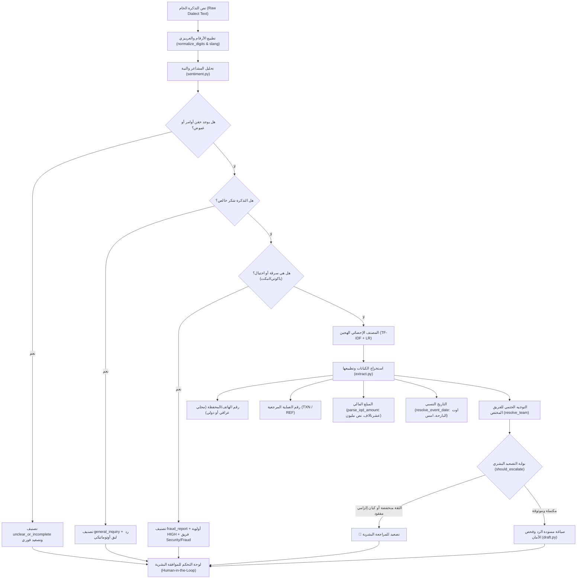

# خريطة المعمارية وهيكلية ملفات مشروع SupportPipe (ARCHITECTURE_MAP.md)

**منظومة أتمتة وتوجيه الدعم الفني الذكية لشركات التكنولوجيا المالية العراقية**  
**Agentic AI Challenge Iraq - Topic 06**  
**تاريخ التحديث:** 22/09/2026

---

## 1. الهيكل الشجري للمشروع (Project Tree)

```text
zine/
├── .github/
│   └── workflows/
│       └── ci.yml                         # خط سير العمل لفحص GitHub Actions الآلي (Matrix 3.12, 3.13)
├── data/
│   ├── raw/
│   │   └── tickets_synthetic_116.jsonl    # قاعدة البيانات المصطنعة الأولية (116 تذكرة)
│   └── splits/
│       ├── dev.jsonl                      # بيانات تدريب الموديل الأوفلاين (متاح للتدريب)
│       └── test.jsonl                     # مجموعة الاختبار المجمدة (محمية ومغلقة لتقييم المحكمين)
├── docs/
│   ├── decisions/                         # سجل القرارات المعمارية (ADRs)
│   │   ├── ADR-0001-stack.md             # مبررات اختيار الحزمة البرمجية (Python, uv, Pydantic v2)
│   │   ├── ADR-0002-batch-pipeline.md    # معمارية خط المعالجة المتسلسل (Typed Sequential Pipeline)
│   │   ├── ADR-0003-deterministic.md     # جدول التوجيه الحتمي المغلق لمنع الهلوسة
│   │   └── ADR-0004-decision-model.md    # دمج نموذج Jev 1.13 السحابي والمحرك الهجين
│   ├── self_audit/                        # سجلات التدقيق الذاتي لمراحل المسابقة
│   │   ├── M0.md                          # التدقيق التأسيسي (Foundations)
│   │   ├── M1.md                          # تدقيق خط المعالجة والتصنيف (Core Pipeline)
│   │   ├── M2.md                          # تدقيق بوابة الأمان وتقليل التصعيد (Safety & Escalation)
│   │   └── M3.md                          # تدقيق رصد الأعطال الجماعية (Systemic Incident Detection)
│   ├── ARCHITECTURE_MAP.md                # هذا الملف (دليل وخريطة كاملة للمشروع)
│   ├── BRIEF_DIGEST.md                    # ملخص متطلبات المسابقة وشروط التحكيم
│   └── slides_evidence.md                 # جداول الأدلة والإحصائيات للعرض التقديمي
├── results/                               # مخرجات عمليات التقييم الرسمية (Evaluations & Confusion Matrices)
├── src/
│   └── supportpipe/                       # الحزمة البرمجية الأساسية للمنظومة
│       ├── classify/                      # وحدة التصنيف واتخاذ القرار
│       │   ├── providers/                 # مزودو محركات الذكاء الاصطناعي
│       │   │   ├── base.py                # الواجهة التجريدية (BaseClassifierProvider)
│       │   │   ├── mock_provider.py       # محرك الأوفلاين الهجين (ML + Dialect Heuristics)
│       │   │   └── jev_provider.py        # مزود نموذج Jev 1.13 السحابي
│       │   ├── classify.py                # موجه التصنيف الرئيسي وسلسلة البدائل (Fallback Chain)
│       │   └── sentiment.py               # [جديد] محرك تحليل اللهجة والمشاعر العراقية (الغضب، الاستعجال، الشكر)
│       ├── datagen/                       # مولد البيانات المصطنعة باللهجة العراقية
│       │   └── generate.py
│       ├── draft/                         # وحدة صياغة الردود وضبط الجودة
│       │   ├── draft.py                   # مدير صياغة الردود وتطبيق القوالب
│       │   ├── templates_ar.yaml          # قوالب الردود المعتمدة باللهجة العراقية
│       │   └── validate.py                # فاحص الأمان ومنع الوعود المطلقة والهلوسة
│       ├── evaluation/                    # أدوات التقييم واحتساب مصفوفة الالتباس
│       │   ├── evaluate.py                # سكربت التقييم الرسمي للمسابقة
│       │   └── spike_jev.py               # سكربت فحص اتصال واستجابة نموذج Jev السحابي
│       ├── extract/                       # وحدة استخراج وتطبيع الكيانات
│       │   ├── extract.py                 # مستخرج أرقام العمليات، المبالغ، التواريخ، والهواتف
│       │   ├── normalize.py               # تطبيع العربيزي، المبالغ المتصلة، التواريخ، وأرقام الهواتف
│       │   └── validate.py                # التحقق من اكتمال الكيانات الإلزامية لكل فئة
│       ├── patterns/                      # وحدة اكتشاف الأعطال والحوادث الجماعية
│       │   └── report.py                  # تجميع التذاكر المتزامنة واكتشاف انقطاع بوابات SMS والشبكات
│       ├── routing/                       # وحدة التوجيه والتصعيد البشري
│       │   ├── escalation.py              # منطق وبوابات التصعيد الحتمية (عتبات الثقة، الكيانات المفقودة)
│       │   └── route.py                   # التوجيه الحتمي للفرق (Routing Table Resolution)
│       ├── taxonomy/                      # التصنيف المعتمد والقواعد التشغيلية
│       │   ├── categories.yaml            # الفئات الـ 14 المغلقة ودرجات الأدلة (Evidence Grades)
│       │   ├── loader.py                  # قارئ ومحقق ملفات الـ Taxonomy
│       │   ├── priority_rubric.yaml       # معايير تحديد الأولويات (High, Medium, Low)
│       │   └── routing_table.yaml         # جدول توجيه الفئات إلى الفرق الخمسة
│       ├── ui/                            # لوحة التحكم وتجربة المستخدم (Streamlit)
│       │   └── app.py                     # واجهة الفحص الحي، المقارنة الثنائية، وطابور المراجعة
│       ├── cli.py                         # واجهة سطر الأوامر (Command-Line Interface)
│       ├── config.py                      # إعدادات المنظومة ومتغيرات البيئة (Pydantic Settings)
│       ├── pipeline.py                    # منسق خط المعالجة المتسلسل (Core Orchestrator)
│       └── schemas.py                     # نماذج البيانات والمخططات الصارمة (Pydantic Models)
├── tests/                                 # الاختبارات المؤتمتة (37 اختباراً بنسبة نجاح 100%)
│   ├── conftest.py                        # تجهيزات الاختبار والبيئة الافتراضية
│   ├── test_dialect_sentiment.py          # [جديد] اختبارات مشاعر اللهجة العراقية والهواتف والاستعجال
│   ├── test_escalation.py                 # اختبارات سياسات التصعيد البشري
│   ├── test_failure_modes.py              # اختبارات أوضاع الفشل الستة المعتمدة
│   ├── test_normalizers.py                # اختبارات تطبيع الأرقام والتواريخ والمبالغ
│   ├── test_patterns.py                   # اختبارات اكتشاف الأعطال الجماعية
│   ├── test_pipeline_integration.py       # اختبارات التكامل الشامل لخط المعالجة
│   ├── test_scaffold.py                   # اختبارات التأسيس والتحقق من الإصدار
│   └── test_taxonomy.py                   # اختبارات صحة تصنيف الفئات والفرق
├── .env.example                           # نموذج متغيرات البيئة ومفاتيح الـ API
├── DISCLOSURE.md                          # وثيقة الإفصاح عن النماذج والمكتبات (شرط البوابة الثالثة)
├── FAILURE_MODES.md                       # وثيقة أوضاع الفشل الستة وآليات معالجتها
├── pyproject.toml                         # تعريف المشروع والاعتماديات (Astral uv)
└── README.md                              # الدليل التعريفي الرسمي للمستودع
```

---

## 2. دورة حياة معالجة التذكرة (Ticket Request Lifecycle)

عند استلام نص رسالة العميل (باللهجة الدارجة العراقية أو العربيزي):



---

## 3. تفصيل الملفات الأساسية ووظيفة كل ملف

### أ) طبقة المعالجة اللغوية والاستخراج (`supportpipe/extract/`)
* **[`normalize.py`](file:///c:/Users/heyder/Desktop/dev/zine/src/supportpipe/extract/normalize.py):**
  - `normalize_digits`: تحويل الأرقام الهندية/العربية `٠١٢٣` إلى أرقام لاتينية `0123`.
  - `normalize_arabizi_and_slang`: تحويل مفردات العربيزي والشات إلى كلمات مفهومة (`ترانسفير` $\rightarrow$ تحويل، `لوجين` $\rightarrow$ تسجيل دخول).
  - `parse_iqd_amount`: استخراج الأرقام المتصلة والمختصرة في الشارع العراقي (`عشرتالاف` $\rightarrow$ 10,000، `نص مليون` $\rightarrow$ 500,000، `25k` $\rightarrow$ 25,000).
  - `resolve_event_date`: تحويل العبارات الزمنية الدارجة إلى تواريخ رسمية (`اوت البارحة` $\rightarrow$ قبل يومين، `امس بالليل` $\rightarrow$ البارحة، `الجمعة الفاتت`).
  - `normalize_phone_number`: استخراج وتوحيد أرقام الهواتف والمحافظ العراقية (`0780xxxxxxx`) والأرقام الدولية (`+971...`) والتفريق بينهما.
  - `mask_phone_number`: إخفاء الأرقام الوسطية لحماية خصوصية العملاء (`0780****567`).

* **[`extract.py`](file:///c:/Users/heyder/Desktop/dev/zine/src/supportpipe/extract/extract.py):**
  - `extract_entities_offline`: يستخرج الهاتف أولاً ثم يعزله لمنع تصادمه مع أرقام العمليات أو المبالغ، ثم يستخرج المرجع والمبلغ والتاريخ ويحسب نسبة ثقة الاستخراج.

* **[`validate.py`](file:///c:/Users/heyder/Desktop/dev/zine/src/supportpipe/extract/validate.py):**
  - فحص مطابقة الكيانات مع شروط الفئة (مثلاً: التحويل المعلق يتطلب حتماً رقم مرجع ومبلغ مالي صحيح).

---

### ب) طبقة الذكاء الاصطناعي والتصنيف (`supportpipe/classify/`)
* **[`sentiment.py`](file:///c:/Users/heyder/Desktop/dev/zine/src/supportpipe/classify/sentiment.py):**
  - `analyze_iraqi_sentiment_and_intent`: محرك استدلال لغوي عراقي عميق:
    1. يكشف السباب والغضب الحاد (`انعل`, `طايح حظكم`, `قشامر`, `كلش ضايج`) ويرفع الأولوية حتماً إلى `HIGH`.
    2. يكشف الاستعجال وظروف الطوارئ (`هسة هسة`, `بالمستشفى`, `ضروري حيل`) ويضبط الاستعجال كـ `critical`.
    3. يميز بدقة بين:
       - الشكر الخالص (`شكرا حليتوا المشكلة بسرعة`).
       - الشكر الاستعجالي (`شكرا بس ممكن تستعجلون؟`).
       - الشكر المتبوع بشكوى مالية (`عاشت ايدكم بس الحوالة ما وصلت`).
    4. يرصد مفردات الاحتيال والسرقة لجميع المحافظات (`باكوني`, `انبكت`, `قفاصة`, `طيروا فلوسي`).

* **[`providers/mock_provider.py`](file:///c:/Users/heyder/Desktop/dev/zine/src/supportpipe/classify/providers/mock_provider.py):**
  - نموذج محلي سريع جداً (~2.7ms) يجمع بين التدريب الإحصائي (`TF-IDF + LogisticRegression`) على ملف `dev.jsonl` مع حواجز الأمان الحتمية لتحقيق أعلى دقة أوفلاين.

* **[`providers/jev_provider.py`](file:///c:/Users/heyder/Desktop/dev/zine/src/supportpipe/classify/providers/jev_provider.py):**
  - الربط مع API نموذج Jev 1.13 السحابي المتخصص في اتخاذ القرارات المصرفية.

---

### ج) طبقة الأمان والتوجيه والردود (`supportpipe/routing/` & `draft/`)
* **[`routing/escalation.py`](file:///c:/Users/heyder/Desktop/dev/zine/src/supportpipe/routing/escalation.py):**
  - `should_escalate`: دالة نقية تحدد ما إذا كانت التذكرة تتطلب تدخلاً بشرياً (إذا كانت الثقة أقل من 65%، أو غاب حقل مطلوب، أو وُجد احتيال/غموض).
* **[`routing/route.py`](file:///c:/Users/heyder/Desktop/dev/zine/src/supportpipe/routing/route.py):**
  - `resolve_team`: توجيه حتمي للفريق المختص بناءً على جدول `routing_table.yaml`.
* **[`draft/draft.py`](file:///c:/Users/heyder/Desktop/dev/zine/src/supportpipe/draft/draft.py) & [`validate.py`](file:///c:/Users/heyder/Desktop/dev/zine/src/supportpipe/draft/validate.py):**
  - إدارة مسودات الردود ومنع الهلوسة وفحص الأرقام المذكورة بدقة قبل العرض على الموظف.

---

### د) واجهة المستخدم الرسومية (`supportpipe/ui/app.py`)
* تشغيل واجهة Streamlit بتصميم عصري (Obsidian Dark Tech Style):
  - فحص التذاكر الحية وتجربة نصوص الشارع مع 12 زراً سريعاً لمختلف السيناريوهات.
  - المقارنة المزدوجة المباشرة وجهاً لوجه بين نموذج Jev السحابي ونموذج الأوفلاين.
  - طابور مراجعة التذاكر للموظفين لاعتماد أو تعديل الردود.
  - استعراض سجلات الدقة ومصفوفة الالتباس الكاملة (Confusion Matrix).

---

## 4. أوامر التشغيل والتحقق السريعة (Cheat Sheet)

| الإجراء | الأمر في الطرفية (PowerShell) |
|---|---|
| **تشغيل واجهة المنظومة (Streamlit)** | `uv run streamlit run src/supportpipe/ui/app.py --server.port 8501` |
| **تشغيل جميع الاختبارات (37/37)** | `uv run pytest -v` |
| **فحص الجودة والأنواع (Lint & Types)** | `uv run ruff check src tests` ثم `uv run mypy src tests` |
| **تشغيل التقييم الرسمي على Test Set** | `uv run supportpipe eval --split test --mode offline` |
| **توليد تقرير الحوادث والأعطال الجماعية** | `uv run supportpipe patterns --input data/splits/dev.jsonl` |
| **فحص حالة المستودع و Git** | `git status` |

---

## 5. ما تم إنجازه اليوم وما هو جاهز للمتابعة غداً

| الميزة / المحور | الحالة | التفاصيل |
|---|---|---|
| **استخراج أرقام الهواتف والمحافظ** | `مكتمل ومفحوص 100%` | دعم صيغ العراق والمحافظات والأرقام الدولية (+971, +90) مع التشفير والحماية. |
| **محرك المشاعر واللهجة العراقية** | `مكتمل ومفحوص 100%` | تمييز الغضب والسباب، الاستعجال والطوارئ، الشكر الخالص مقابل الشكر الاستعجالي، ومفردات السرقة والاحتيال. |
| **تحديث لوحة التحكم (Streamlit)** | `مكتمل ومفحوص 100%` | إضافة شارات المشاعر الملونة، استعراض الهواتف المشفرة، و12 نموذج اختبار سريع بنقرة واحدة. |
| **الاختبارات الآلية وسلامة الكود** | `مكتمل 37/37 اختبار` | جميع اختبارات `pytest`, `ruff`, و `mypy` تجتاز بنجاح تام وبلا أي خطأ. |
| **المهام المقترحة للمتابعة غداً** | `جاهزة للبدء` | 1. إضافة زر تصدير التقرير التنفيذي الرسمي المطبوع (PDF/Excel Export).<br>2. تسجيل فيديو العرض العملي (Walkthrough Demo). |
