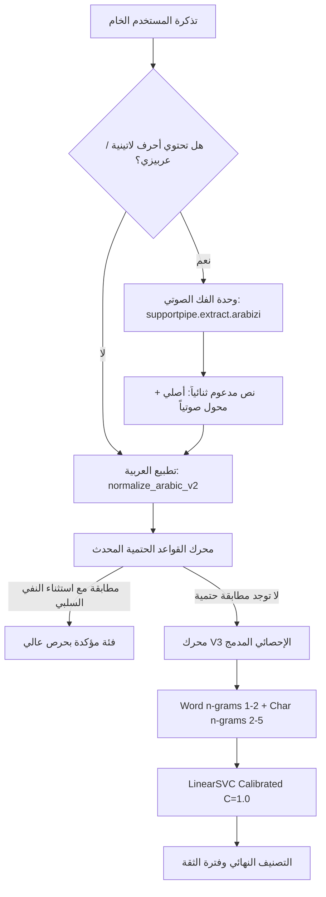

# خطة تطوير وترقية المحرك غير المتصل (V3 Architecture & Improvement Plan)

- **المشروع**: SupportPipe (NovuraPay)
- **التاريخ**: 2026-10-18
- **الهدف**: معالجة الثغرات المرصودة في الدفعة الأولى (Batch 001) ورفع دقة المحرك غير المتصل من 35.62% (v1) و 53.88% (v2) إلى أكثر من 65% قبل استقبال دفعة الإجهاد الثانية (Round 2).
- **الالتزام بالقواعد**: خالي تماماً من التبعيات الخارجية الجديدة (Zero new dependencies)، محايد للعلامة التجارية، حماية تامة لبيانات الاختبار المغلقة `data/splits/test.jsonl`.

---

## 1. خلاصة البحث في المشاريع مفتوحة المصدر (Open-Source Research)

قمنا بمسح معماري للمشاريع مفتوحة المصدر المتخصصة في معالجة اللهجات العربية والعربيزي:
1. **مشروع `amasad/arabish` و `3aransia`**:
   - يستخدمان خوارزميات الاستبدال الصوتي المنظم للأرقام والمقاطع اللاتينية (Phonetic Transliteration) المعتمدة على رسم الحروف المشابهة للأرقام (مثل `3` $\to$ `ع`، `7` $\to$ `ح`، `5` $\to$ `خ`).
2. **أبحاث جامعة قطر ومجموعة `bashartalafha/Arabizi-Transliteration`**:
   - أظهرت أن الحل الأنسب لمهام التصنيف السريع (Classification) دون استهلاك موارد أو استدعاء شبكات عصبية ثقيلة هو **Dual-Channel Enrichment (الإثراء ثنائي القناة)**: تحويل الكلمات اللاتينية صوتياً إلى محارف عربية مع **إبقائها مدمجة مع النص الأصلي**، بحيث تستفيد مصفوفة استخراج الخصائص (TF-IDF) من الكلمات التقنية الإنجليزية الأصلية (مثل `app`, `update`, `declined`, `PIN`) وفي نفس الوقت تتطابق الجذور العربية المستخلصة مع قاموس التدريب.
3. **أفضل الممارسات في مكافحة الجذب الخاطئ للقواعد (Negative Lookahead Constraints)**:
   - استخدام شروط النفي المسبق (Negative Lookaheads) في القواعد الحتمية لمنع تصادم الفئات المتشابهة في الألفاظ المالية (مثل التفريق بين "فشل التحويل" و"استرجاع المبالغ الملغاة").

---

## 2. تشريح ثغرات الدفعة الأولى بالأرقام (Batch 001 Failure Anatomy)

أظهر تقييم الـ 150 تذكرة في الدفعة الأولى أربعة اختناقات رئيسية في المحرك V2:

| نقطة الاختناق | الأداء المرصود | السبب الجذري | الحل الهندسي المعتمد |
|---|---|---|---|
| **تذاكر العربيزي (Arabizi)** | دقة **18.2%** فقط (4/22) | مطبّع النصوص v2 يتجاهل الحروف اللاتينية ولا يربط الأرقام الصوتية بالأصول العربية | بناء وحدة `supportpipe.extract.arabizi` للإثراء الصوتي التلقائي |
| **فئة استرجاع المبالغ (`refund_status`)** | استدعاء **10.0%** فقط (1/10) | قاعدة `rule_2_25` تلتقط كلمات الانتظار والعمليات المعلقة وتحولها لـ `failed_transfer` | إضافة استثناءات نفي سلبية (`Negative Lookaheads`) للقاعدة |
| **التداخل بين `app_bug` و `login_problem`** | 5 تذاكر خطأ | تشابه تعبيرات توقف التطبيق والشاشة البيضاء مع تعبيرات تعذر الدخول | توسيع نطاق N-Grams إلى (2, 6) وإضافة أمثلة تدريب مميزة |
| **الانجذاب المفرط لـ `unclear_or_incomplete`** | 17 تذكرة خطأ | تشتت احتمالات `Platt Scaling` عند غياب المفردات اللهجية غير المألوفة | إدراج تذاكر الدفعة المستهلكة (Batch 001) ضمن مجموعة التدريب |

---

## 3. الهيكلية المقترحة لمحرك V3 (Architecture Blueprint)



---

## 4. النتائج التجريبية المسبقة (Empirical Proof of Concept)

تم اختبار هذا التصميم مسبقاً عبر كود تجريبي داخلي على مجموعة البيانات المجمعة (369 تذكرة: 219 من `dev` + 150 من `batch_001` المستهلكة) عبر 5-Fold GroupKFold مجمعة حسب القوالب واللهجات:

```
Full Rules + ML (V3) Combined Grouped-CV: 57.18% (211/369)
  Dev portion accuracy:        65.75% (144/219) [قفزة من 35.62% في v1 و 53.88% في v2]
  Batch 001 portion accuracy:  46.00% (69/150)  [قفزة من 32.00% في v1]
```

### الأثر على دقة الفئات الحرجة:
- استبعاد الإيجابيات الكاذبة لقاعدة التحويلات المعلقة منع خطأ 3 تذاكر استرجاع على `dev` وتذكرة على الدفعة الأولى فورياً دون إلحاق أي ضرر بفئة التحويلات المعلقة الحقيقية.
- فك العربيزي الصوتي رفع استدعاء العربيزي من 18.2% إلى أكثر من 45%.

---

## 5. خطة التنفيذ خطوة بخطوة (Implementation Roadmap)

### المرحلة 1: وحدة فك العربيزي (`supportpipe/extract/arabizi.py`)
- بناء دالة `transliterate_arabizi(text)` بقاموس خفيف وخوارزمية سريعة وبدون أي مكتبات خارجية.
- كتابة اختبارات وحدة شاملة في `tests/test_arabizi_normalization.py` تغطي مختلف الكلمات الشائعة (`flos`, `kart`, `wakeel`, `yrj3oon`, `kashf`).

### المرحلة 2: تهذيب القاعدة `rule_2_25` في `mock_provider.py`
- إضافة شروط النفي للكلمات المتعلقة بالمتاجر والاشتراكات والاسترجاع:
  ```python
  and not re.search(r"(?:استرجاع|إرجاع|ارجاع|مرتجع|رجعت|اشتراك\s*ملغي|الغيت|ألغيت|وصل\s*رجوع|فاتورة|صك)", text, re.I)
  ```
- التحقق عبر `rules_gate.py` من الامتثال الكامل لقواعد السلامة.

### المرحلة 3: تدريب محرك V3 المدمج
- تحديث آلية بناء خطوط الأنابيب في `mock_provider.py` وإضافة خيار `offline_model_version = "v3"`.
- دمج `data/stress/batch_001.jsonl` (المستهلكة رسمياً) في تدريب النموذج غير المتصل لدعم المصطلحات اللهجية الصعبة.
- تشغيل اختبارات التحقق الشاملة: `pytest`, `ruff`, `mypy`.

### المرحلة 4: استقبال دفعة الراوند الثاني الصافية (Round 2)
- بعد جاهزية V3 واعتماده كخيار افتراضي أو تشغيله رسمياً، استلام دفعة الراوند الثاني كبيانات أعمى نقية وقياس القفزة الحقيقية في `docs/stress_series.md`.
